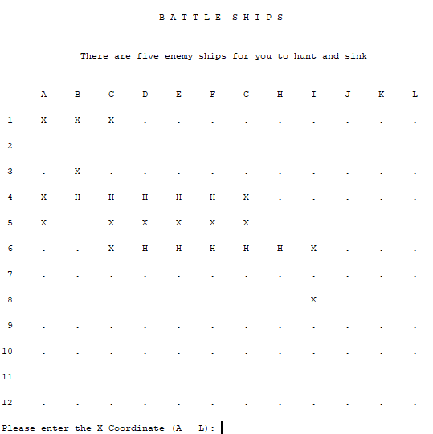
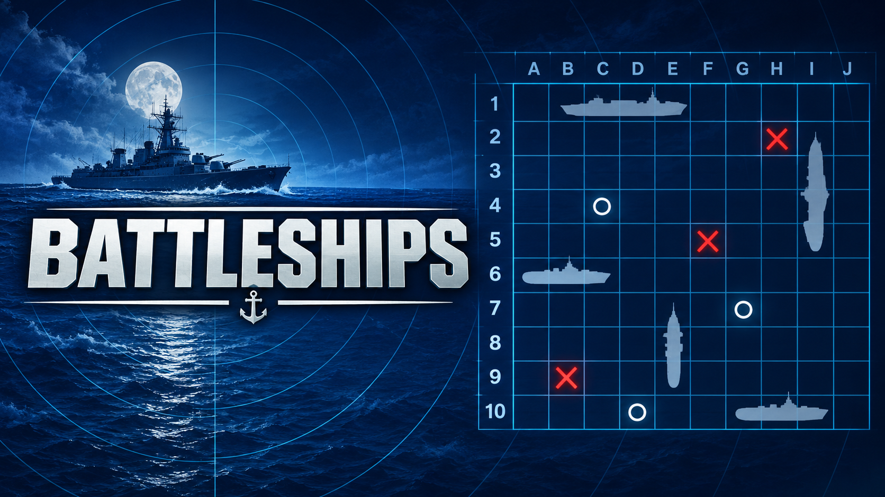

# BATTLESHIPS
## YOU SUNK MY BATTLESHIP
### JAVA NAVAL COMBAT GAME

BATTLESHIPS is a Java-based implementation of the famous Battleships strategy game, developed as a command-line application using object-oriented programming.

The project recreates the classic naval warfare experience through a coordinate-based battlefield where the player must locate and sink five concealed enemy ships.

The game uses a 12 × 12 battlefield, with alphabetical X-axis coordinates and numerical Y-axis coordinates. Players enter targeting coordinates through the keyboard, attempting to identify enemy ship positions and eliminate the entire fleet.

The application is built around three Java source files, separating the main game engine, battlefield management and ship-position data into individual classes.

The project demonstrates Java programming fundamentals, including arrays, classes, objects, methods, loops, conditional logic, keyboard input and structured data management.

## PROJECT OVERVIEW

| Project | Details |
|---|---|
| Project | BATTLESHIPS |
| Alternative title | YOU SUNK MY BATTLESHIP |
| Release | Version 1.0 |
| Language | Java |
| Interface | Command-line / Console |
| Battlefield | 12 × 12 grid |
| Enemy fleet | Five battleships |
| Targeting system | Alphabetical and numerical coordinates |
| Input method | Keyboard |
| Architecture | Object-oriented Java |
| Package | BattleShipsProj |
| Status | Tested and working |

## CORE CAPABILITIES & GAME FEATURES

### 01. ⚓ Naval Battlefield & Grid Management

Creation of a 12 × 12 naval battlefield.
Alphabetical X-axis coordinates from A to L.
Numerical Y-axis coordinates from 1 to 12.
Initialisation of battlefield positions.
Separate battlefield objects for structured grid management.
Display of the battlefield through the console.
Dynamic updating of grid positions during gameplay.
Representation of targeting results directly on the battlefield.

### 02. 🚢 Enemy Fleet & Ship Management

Creation of five enemy battleships.
Individual ship-position data structures.
Initialisation of ship locations before gameplay begins.
Storage of ship positions using Java arrays.
Representation of occupied and unoccupied battlefield locations.
Separation of ship-management functionality into the Ships class.
Tracking of remaining enemy ship positions.

### 03. 🎯 Coordinate-Based Targeting System

Keyboard-based targeting.
Alphabetical coordinate selection from A to L.
Numerical coordinate selection from 1 to 12.
Conversion of alphabetical coordinates into numerical array positions.
Validation of entered alphabetical coordinates.
Validation of numerical coordinates against the battlefield boundaries.
Repeated input requests when coordinates are outside the accepted range.

### 04. 💥 Hit & Miss Detection

Comparison of player-selected coordinates against stored enemy ship positions.
Identification of successful ship strikes.
Detection of unsuccessful targeting attempts.
Recording of misses using an X marker.
Recording of successful hits using an H marker.
Updating of battlefield information following each targeting attempt.
Reduction of the remaining ship-position counter following successful hits.

### 05. 🗺️ Battlefield Display & Visual Feedback

Console-based battlefield rendering.
Display of alphabetical grid headings.
Display of numerical battlefield coordinates.
Presentation of the BATTLESHIPS game heading.
Visual representation of hit and miss positions.
Refresh of battlefield information following player actions.
Continuous display of the current battlefield throughout gameplay.

### 06. 🔄 Game Engine & Control Flow

Centralised execution through the BattleShips main class.
Initialisation of battlefield and ship objects.
Population of battlefield arrays.
Placement of the five enemy ships.
Continuous gameplay using a while loop.
Keyboard input through the Java Scanner class.
Conditional evaluation of targeting results.
Automatic termination when all 25 enemy ship positions have been hit.

### 07. 🧩 Object-Oriented Java Architecture

Separation of application functionality into three Java classes.

BattleShips.java provides the main game engine, initialisation, keyboard input, coordinate processing and battlefield display.

Battle.java manages battlefield grid data, headings and hit/miss markers.

Ships.java manages ship-position data, initialisation and retrieval of stored ship locations.

Use of private array variables.
Use of public methods for controlled data access.
Creation and management of multiple class instances.
Use of Java objects and arrays to represent the game environment.

### 08. ⌨️ Interactive Console Gameplay

Keyboard-driven gameplay without requiring a graphical interface.
Player interaction through coordinate prompts.
Continuous battlefield updates.
Input validation for the accepted coordinate ranges.
Simple command-line execution.
Clear game instructions and battlefield presentation.

### 09. 🏁 Victory Condition & Game Completion

Five enemy battleships are placed within the battlefield.
The player must discover and successfully hit all 25 occupied positions.
The remaining target counter is updated following successful hits.
The main gameplay loop continues until the counter reaches zero.
The application then exits the game loop and completes execution.

## GAMEPLAY MECHANICS

BATTLESHIPS follows a coordinate-based naval targeting system.

The battlefield contains 144 possible positions arranged across 12 rows and 12 columns.

The player is presented with the battlefield and asked to enter two coordinates:

X COORDINATE: A – L

Y COORDINATE: 1 – 12

The selected coordinates are translated into array positions and compared against the stored enemy ship locations.

A successful strike is recorded as an H marker.

An unsuccessful strike is recorded as an X marker.

The battlefield is updated to reflect the player's actions.

The objective is to locate and destroy all five enemy battleships, accounting for their 25 occupied positions.

## PROJECT OBJECTIVES

BATTLESHIPS was developed to provide a practical Java implementation of a familiar strategy game while demonstrating fundamental programming techniques.

The principal objectives include:

Object-oriented development: Implement game functionality using separate Java classes and objects.

Array management: Represent the battlefield and enemy ship positions using structured arrays.

Game logic: Implement the rules governing targeting, hit detection and game completion.

Coordinate processing: Translate player-entered alphabetical and numerical coordinates into battlefield array positions.

Input validation: Ensure that entered coordinates fall within the supported battlefield boundaries.

Interactive development: Provide a keyboard-driven console experience.

Code organisation: Separate the main game engine, battlefield operations and ship management into individual source files.

## INTENDED USE CASES

Java programming education and practical development exercises.

Object-oriented programming demonstrations.

Java array and data-structure exercises.

Command-line application development.

Interactive keyboard-input programming.

Game logic and conditional-processing demonstrations.

Introduction to coordinate-based game mechanics.

Practical study of Java classes, methods, objects and loops.

## REQUIREMENTS

Java Development Kit (JDK).

Java compiler (javac).

Java Runtime Environment.

Command-line terminal or Java-compatible development environment.

The three supplied Java source files.

No external database or third-party Java libraries are required by the supplied implementation.

## INSTALLATION & USAGE

Clone the repository:

    git clone https://github.com/BroadbentT/BATTLESHIPS.git

Enter the project directory:

    cd BATTLESHIPS

Check the Java installation:

    java -version

    javac -version

Compile the Java source files:

    javac -d . Battle.java Ships.java BattleShips.java

Launch the game:

    java BattleShipsProj.BattleShips

Follow the on-screen prompts to enter the X and Y coordinates of each targeting attempt.

Continue playing until all enemy ship positions have been successfully identified.

## PROJECT FILES & METADATA

| LANGUAGE / TYPE | FILENAME | MD5 HASH | DESCRIPTION |
|---|---|---|---|
| Java | BattleShips.java | c3c1a06b34a93e1e7f86f327502ed1a8 | Main Game Engine |
| Java | Battle.java | 82d6841609ff26a46d687f6196c2bfaa | Battlefield Management |
| Java | Ships.java | ca7235004bb1a65aec9274e7e4cf9b53 | Ship Management |
 
Additional project resources:

| FILE | DESCRIPTION |
|---|---|
| BS.PNG | Console Display Screenshot |
| Battleships_ Moonlit Radar Warzone.png | Project Artwork |

- [x] Tested and working...
- [x] Java source files included.
- [x] Battlefield initialisation implemented.
- [x] Enemy fleet placement implemented.
- [x] Coordinate-based targeting implemented.
- [x] Hit and miss tracking implemented.

## RELEASE NOTES & DEVELOPMENT STATUS

**VERSION 1.0 — JAVA BATTLESHIPS**

Original Java implementation of the classic Battleships game.

Three-class application architecture.
12 × 12 coordinate-based battlefield.
Five enemy battleships.
Keyboard-controlled targeting.
Console-based battlefield display.
Automated game completion condition.

## BATTLESHIPS — CONSOLE DISPLAY

The original console interface provides the player with the battlefield, coordinate headings and targeting prompts.

The battlefield is updated as the player attempts to locate and sink the enemy fleet.

## PROJECT ARTWORK — MOONLIT RADAR WARZONE

The project artwork represents the naval warfare theme behind BATTLESHIPS, combining a moonlit ocean, battleship imagery and tactical radar targeting graphics.

  

## REFERENCES & FURTHER LEARNING

BATTLESHIPS — GitHub Repository

Oracle — Java Documentation

Oracle — Java Language Basics

Oracle — Java Arrays

Oracle — Java Classes and Objects

Oracle — Java Scanner Class

## SUPPORT THE PROJECT

Found this project interesting, or would like to support further development?

Explore the source code, review the implementation and follow future project updates through GitHub.

**BATTLESHIPS — YOU SUNK MY BATTLESHIP**

*Locate. Target. Strike. Sink.*
